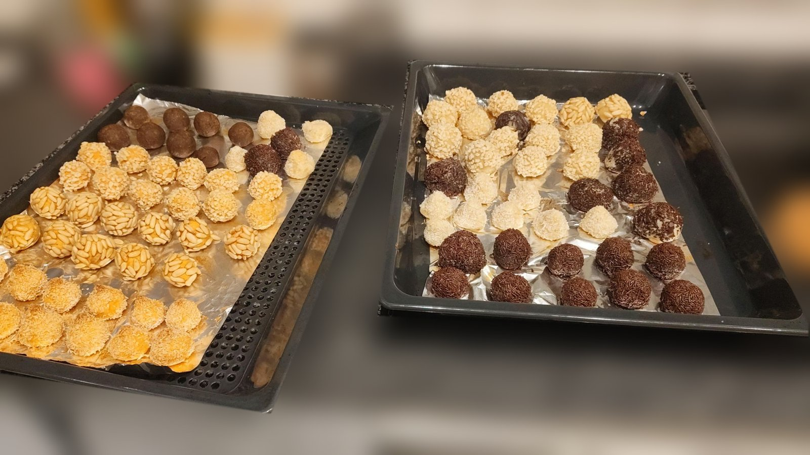

## Ingredients
- 250g de patata o de moniato (qualsevol dels dos funciona)
- 250g d'ametlla mòlta
- 100g de sucre
- 1 ou (separar el rovell i la clara)
- Pell ratllada d'1 llimona
- Per arrebossar: pinyons, ametlla picada, coco ratllat, xocolata en fideus o cacau en pols

## Elaboració
Bullir la patata o el moniato amb pell fins que estigui ben tou (uns 20-30 minuts). També es pot coure al forn. Pelar-lo i fer-ne un puré mentre encara és calent. Deixar refredar.

Dins un bol, barrejar el puré amb l'ametlla mòlta, el sucre, la pell de llimona i el rovell de l'ou. Amassar amb les mans fins que quedi una massa homogènia que no s'enganxi. Si queda massa tova, afegir-hi una mica més d'ametlla. Tapar-la i deixar-la reposar a la nevera unes hores, o millor, tota la nit.

Fer boletes d'uns 20g. Batre lleugerament la clara, passar-hi cada boleta i arrebossar-la amb pinyons, ametlla, coco o xocolata. Els de pinyons s'han de prémer una mica perquè s'hi enganxin bé. Si es vol, la massa es pot dividir abans i barrejar-ne una part amb cacau en pols o amb coco.

Preescalfar el forn a 200 ºC. Col·locar els panellets en una safata amb paper de forn i pintar els de pinyons amb una mica de rovell batut. Enfornar uns 8-10 minuts, fins que estiguin daurats. Els de xocolata no cal enfornar-los. Deixar refredar abans de menjar-los.

